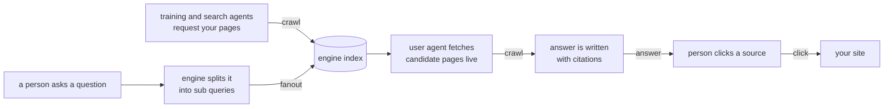

# Best AEO Tracking Tools

<p align="center">
  <a href="https://aiclicks.io/">
  </a>
</p>

Most roundups of the [best AEO tracking tools](https://aiclicks.io/blog/best-aeo-tracking-tools) compare dashboards. This repo compares where each tool takes its measurement. Before a page earns anything from an answer engine it has to be crawled, retrieved, written into an answer and clicked. Each of those four steps leaves a different record: a line in your access log, a sub query, a citation, a referral. A tracker that reads one of them cannot tell you at which step a page dropped out.

Sixteen tools are filed in [tools.yaml](tools.yaml) by the steps they read. Fifteen of them read the answer and three read the crawl, so the repo also ships `aeolog`, a standard library Python package that reads the crawl step from the access logs you already have and joins it to the citation export of whichever tracker you buy.

```
.
├── tools.yaml               16 tools, each tagged with the taps it reads
├── render_table.py          tools.yaml -> both README tables, --check, --need
├── aeolog/
│   ├── agents.py            16 AI user agents by purpose, 10 AI referrer hosts
│   ├── parse.py             combined log format, .gz and stdin
│   ├── report.py            per agent, per purpose, per path, funnel, gaps
│   └── __main__.py          python -m aeolog
├── examples/
│   ├── access.example.log   1,764 synthetic requests, four planted problems
│   ├── cited.example.csv    citation export in the shape aeolog joins
│   ├── aiclicks_cited.py    builds that CSV from the AIclicks API
│   └── make_sample.py       seeded generator for the two sample files
├── tests/                   22 unittest cases, no network
└── .github/workflows/       table check, tests on Python 3.10 and 3.14, link check
```

## Four taps on one request path



A tap is a point on that path where something gets written down.

| Tap | The record it leaves | Who can read it | What it cannot tell you |
| --- | --- | --- | --- |
| `crawl` | A request in your access log with an AI user agent | You, or a log analysis tool | Whether the page made it into an answer |
| `fanout` | The searches the engine ran for one prompt | Tools that capture the engine's own sub queries | Which result the engine picked |
| `answer` | The stored answer text with brand mentions and cited URLs | Any tracker that runs prompts on a schedule | Why a page was skipped |
| `click` | A referrer header or a `utm_source` tag on a visit | You, in analytics or the same access log | Answers that named you and sent nobody |

The `answer` tap and the `crawl` tap differ in kind. An answer tracker samples: it runs the prompts you chose, on the engines your plan includes, and reports proportions. Your access log is a census: every request an agent made, whether or not you ever thought of the question behind it. Most AEO trackers sell the sample. The census is already sitting on your server.

## Comparison

Generated from [tools.yaml](tools.yaml) by [render_table.py](render_table.py). **Blind to** is computed as the taps a tool does not read. `Not published` means the roundup and the vendor summary do not say.

<!-- TABLE:START -->
| Tool | Taps | Blind to | How it captures | Engines | Entry price | Entry volume | Developer surface |
| --- | --- | --- | --- | --- | --- | --- | --- |
| [AIclicks](https://aiclicks.io) | fanout, answer, click | crawl | Daily prompt runs on each engine you pick | 3 on Starter, you pick | $59/mo, 3 day trial | 30 prompts, run daily | REST API and MCP server on Pro and Business, CSV export on every plan |
| [AirOps](https://www.airops.com/) | answer | crawl, fanout, click | Not published | ChatGPT, Gemini, Perplexity, Google AI | Free | 100 prompts, 20k tasks | Bulk workflows, direct CMS publishing |
| [Cognizo](https://www.cognizo.ai/) | answer, click | crawl, fanout | UI scraping of the rendered answer | 3 of 10 on Core | $149/mo, billed yearly | 50 prompts | API on Enterprise, OpenAI Conversions API for ads |
| [Promptwatch](https://promptwatch.com/) | crawl, answer | fanout, click | Crawler logs joined to cited pages | 11 platforms | $95/mo | 50 prompts, 6,000 responses | Publishes to Webflow, Framer and WordPress |
| [Gauge](https://www.withgauge.com/) | answer | crawl, fanout, click | Not published | ChatGPT, Gemini, Perplexity, AI Overviews | Custom | Not stated | Analytics integrations |
| [Surfer AI Tracker](https://surferseo.com/ai-tracker/) | fanout, answer | crawl, click | Not published | ChatGPT at entry, 5 platforms on Pro | $99/mo | Not stated at entry, 50 prompts on Pro | CMS integration on Pro |
| [Rank Prompt](https://rankprompt.com) | answer | crawl, fanout, click | Not published | ChatGPT, Gemini, Perplexity | $49/mo | 150 credits | Not stated |
| [Track My Visibility](https://trackmyvisibility.com/) | answer | crawl, fanout, click | Not published | 3 platforms on Discover | $89/mo, $5 one time trial | 50 prompts a day | Not stated |
| [Qwairy](https://www.qwairy.co/) | crawl, answer | fanout, click | Not published | ChatGPT, Perplexity, Gemini, Claude | $79/mo | Not stated | Not stated |
| [SE Ranking AI Search Toolkit](https://seranking.com) | answer | crawl, fanout, click | Not published | AI Overviews, Gemini, ChatGPT | $65/mo, source table says $89 | Scales by keywords | Not stated |
| [JetOctopus](https://jetoctopus.com/) | crawl | fanout, answer, click | Your server logs, 40+ bots | None, it reads bots and not answers | $349/mo, 7 day trial | Unlimited seats and projects | Logs, crawl and Search Console data joined |
| [ProductRank.ai](https://productrank.ai) | answer | crawl, fanout, click | Not published | Several models | Free | Not stated | Not stated |
| [Gumshoe](https://www.gumshoe.ai) | answer | crawl, fanout, click | Not published | Not stated | $0.10 per conversation | Pay as you go | Not stated |
| [AI SEO Tracker](https://aiseotracker.com/) | answer | crawl, fanout, click | Not published | ChatGPT, Gemini, Claude, Perplexity, Copilot | $79/mo, 7 day trial | 50 prompts, 250 responses, weekly | Agent skills over MCP for Cursor, Claude Code, Codex |
| [Scrunch](https://scrunch.com/) | answer | crawl, fanout, click | Not published | ChatGPT only on Explorer | $100/mo | 100 prompts | Agent Experience Platform serves pages to AI agents |
| [Ahrefs Brand Radar](https://ahrefs.com/brand-radar) | answer | crawl, fanout, click | Shared prompt database | Major models | Free, basic features | Not your own prompt list | Not stated |
<!-- TABLE:END -->

## Coverage by tap

The same data inverted.

<!-- COVERAGE:START -->
| Tap | What is measured | Tools | Count |
| --- | --- | --- | --- |
| `crawl` | AI agent requests in your server logs | Promptwatch, Qwairy, JetOctopus | 3 of 16 |
| `fanout` | Sub queries the engine runs before answering | AIclicks, Surfer AI Tracker | 2 of 16 |
| `answer` | Mentions and citations in the generated answer | AIclicks, AirOps, Cognizo, Promptwatch, Gauge, Surfer AI Tracker, Rank Prompt, Track My Visibility, Qwairy, SE Ranking AI Search Toolkit, ProductRank.ai, Gumshoe, AI SEO Tracker, Scrunch, Ahrefs Brand Radar | 15 of 16 |
| `click` | Visits arriving from an AI answer | AIclicks, Cognizo | 2 of 16 |
<!-- COVERAGE:END -->

No tool on the list reads all four. Ask for the pair that brackets the path and the answer is empty:

```bash
pip install pyyaml
python render_table.py --need crawl,click
python render_table.py --need crawl,answer
```

```
no single tool covers all of those taps, combine two

Qwairy                         $79/mo                           taps: crawl, answer
Promptwatch                    $95/mo                           taps: crawl, answer
```

So a full picture is a stack of two things. One of them can be free if you can get at your own logs.

## Read the crawl tap yourself

`aeolog` needs Python 3.10 or newer and nothing else. It reads the combined log format that nginx, Apache and most CDN log exports use.

```bash
python -m aeolog examples/access.example.log
```

```
1,680 requests, 2026-10-01 to 2026-10-14

agent             vendor        purpose   hits  pages  errors  last seen
----------------  ------------  --------  ----  -----  ------  ----------
GPTBot            OpenAI        training  210   12     6.2%    2026-10-14
OAI-SearchBot     OpenAI        search    112   12     9.8%    2026-10-14
ChatGPT-User      OpenAI        user      112   3      0.0%    2026-10-14
ClaudeBot         Anthropic     training  84    12     19.0%   2026-10-14
Claude-SearchBot  Anthropic     search    42    11     7.1%    2026-10-14
Claude-User       Anthropic     user      28    2      50.0%   2026-10-14
PerplexityBot     Perplexity    search    84    12     8.3%    2026-10-14
Perplexity-User   Perplexity    user      28    1      0.0%    2026-10-14
CCBot             Common Crawl  training  28    11     21.4%   2026-10-14
Bytespider        ByteDance     training  42    12     7.1%    2026-10-14
Googlebot         Google        search    168   12     7.7%    2026-10-14
bingbot           Microsoft     search    84    12     6.0%    2026-10-14
```

The **purpose** column is the part most log reports skip, and it decides what a block costs you.

| Purpose | What the agent does | Examples | If you block it |
| --- | --- | --- | --- |
| `training` | Collects pages that may be used to train models | `GPTBot`, `ClaudeBot`, `CCBot` | Nothing changes in live answers |
| `search` | Builds the index the engine retrieves from | `OAI-SearchBot`, `Claude-SearchBot`, `PerplexityBot` | The page stops being a retrieval candidate |
| `user` | Fetches one page because a person just asked | `ChatGPT-User`, `Claude-User`, `Perplexity-User` | The engine cannot read the page it wanted to cite |

A `robots.txt` that disallows `GPTBot` is a decision about training. One that also catches `OAI-SearchBot` takes the site out of ChatGPT search. Firewalls make the same mistake more quietly, because a bot rule that returns 403 never shows up in `robots.txt` at all. You can confirm the robots side with a [free robots.txt checker](https://aiclicks.io/tools/free-robots-txt-checker), and the firewall side only shows in the log. `python -m aeolog --agents` prints the full registry.

Where the agents spend their requests, and where people arrive from AI answers:

```bash
python -m aeolog examples/access.example.log --by path --top 6
```

```
path                    training  search  user  errors  ai clicks
----------------------  --------  ------  ----  ------  ---------
/blog/compare-trackers  24        43      56    0       42
/blog/log-analysis      23        45      28    0       28
/pricing                27        50      42    0       0
/docs/quickstart        37        41      14    0       14
/features               30        39      14    0       14
/blog/aeo-checklist     33        37      14    23      0
```

`user` is the column to watch. A live fetch means an engine pulled that page while composing an answer for a real person, which is the closest thing a log has to an impression. `ai clicks` counts visits whose referrer is an AI assistant, plus visits tagged `utm_source=chatgpt.com`, which survives when the referrer is stripped.

## Join the crawl tap to the answer tap

Logs say what was fetched. A tracker says what was cited. Joining them by URL shows the step where each page falls out. The join file is a CSV with three columns:

```csv
url,engine,citations
https://example.com/blog/compare-trackers,chatgpt,31
https://example.com/docs/api-reference,perplexity,3
```

Any tracker's citation export works after a column rename. For AIclicks, [examples/aiclicks_cited.py](examples/aiclicks_cited.py) builds it from the documented `GET /api/v1/citations` endpoint, filtered to your own pages, once per engine:

```bash
export AICLICKS_API_KEY=ak_live_...
python examples/aiclicks_cited.py --domain-id <uuid> --days 14 > cited.csv
```

Then count pages per stage:

```bash
python -m aeolog examples/access.example.log --funnel --cited examples/cited.example.csv
```

```
engine      pages  indexed  fetched live  cited  clicked
----------  -----  -------  ------------  -----  -------
chatgpt     13     11       3             2      2
claude      13     9        1             1      1
perplexity  13     11       1             3      1
```

And list the pages that drop out between stages:

```bash
python -m aeolog examples/access.example.log --gaps --cited examples/cited.example.csv
```

```
gap              path                 who                evidence
---------------  -------------------  -----------------  ---------------------------------------------------
blocked          /blog/aeo-checklist  Claude-SearchBot   2 failed, 0 succeeded, mostly 403
blocked          /blog/aeo-checklist  Claude-User        14 failed, 0 succeeded, mostly 403
blocked          /docs/api-reference  Claude-SearchBot   1 failed, 0 succeeded, mostly 404
blocked          /docs/api-reference  Googlebot          13 failed, 0 succeeded, mostly 404
blocked          /docs/api-reference  OAI-SearchBot      11 failed, 0 succeeded, mostly 404
blocked          /docs/api-reference  PerplexityBot      7 failed, 0 succeeded, mostly 404
blocked          /docs/api-reference  bingbot            5 failed, 0 succeeded, mostly 404
not indexed      /changelog           all search agents  people load it, no search agent has
read, not cited  /pricing             chatgpt            42 live fetches, 0 citations
cited, no fetch  /docs/api-reference  perplexity         3 citations, no successful fetch in this log window
```

The sample log has four problems planted in it, and each gap type catches one.

| Gap | What happened in the sample | The fix it points to |
| --- | --- | --- |
| `blocked` | A firewall rule returns 403 to Anthropic agents on one post. OpenAI and Perplexity get 200 on the same URL. | Allow the retrieval agents in the firewall, then rerun. |
| `cited, no fetch` | A docs page moved and now returns 404, and Perplexity still cites the old URL. | Redirect the old URL before the citation decays. |
| `read, not cited` | ChatGPT fetched the pricing page live 42 times in 14 days and never cited it. | The page is reachable and still loses. This is a content problem, and no crawl fix will help. |
| `not indexed` | People read the changelog, and no search agent has requested it. | Link it from a crawled page or add it to the sitemap. |

`read, not cited` is the row no single tool can produce. A log tool sees 42 healthy fetches. An answer tracker sees a page with zero citations and cannot know the engine looked at it. Training agents are left out of `blocked` on purpose, since blocking them is a legitimate choice. Add `--strict` to exit 1 when a retrieval agent is blocked, which turns the report into a cron or CI check, and `--json` to feed it to something else.

## What a log cannot tell you

* **User agents can be faked.** Anyone can send `GPTBot` in a header. Vendors publish IP ranges for their agents, and `aeolog` does not check them. Treat odd spikes as suspect.
* **A CDN can answer before your server does.** Cached responses never reach the origin log. Use the CDN's own logs if you have them.
* **Google has no separate AI agent.** AI Overviews and AI Mode draw on the index `Googlebot` builds, and `Google-Extended` is a `robots.txt` token that never appears in a log. The `Googlebot` row is a proxy.
* **A 200 does not mean the agent saw your content.** The AIclicks roundup notes that AI crawlers do not render JavaScript. A page that builds its body in the browser returns 200 and an empty shell. JetOctopus compares rendered pages against raw HTML for this reason.
* **A log contains no answers.** It cannot say what an engine wrote about you or which competitor it named. That is the `answer` tap, and you need a tracker for it.

## The sixteen tools, grouped by tap

AIclicks is listed first because the shortlist comes from its own roundup. That is disclosed in the credits. Inside each group the order follows the source.

### Fan out, answer and click

**AIclicks.** Runs every tracked prompt once a day on each engine you enable: 3 engines and 30 prompts on Starter at $59, 4 and 150 on Pro at $189, 6 and 300 on Business at $499. It records the sub queries each engine ran for a prompt, and with GA4 connected it reports sessions and key events that arrived from AI assistants. For developers the useful part is that the data is not locked in the dashboard. A read only REST API under `/api/v1/` (bearer key, 60 requests a minute, one hour cache with `fresh=true` to skip it) exposes answers, citations, fan out queries and GA4 traffic, and an MCP server at `mcp.aiclicks.io` wraps the same endpoints for Claude or Cursor. Both need Pro or Business. CSV export is on every plan. It does not read server logs, so the `crawl` tap is yours to cover, which is what `aeolog` is for. The trial is 3 days.

### Crawl and answer

**Promptwatch.** The only tool here whose stated method is the join this repo performs by hand: it logs `GPTBot`, `ClaudeBot` and `PerplexityBot` activity and connects that to which pages get cited, across 11 platforms refreshed daily. A content agent drafts fixes and publishes to Webflow, Framer and WordPress. Essential is $95 for 1 project, 50 prompts and 6,000 responses. Professional at $245 adds Agent Analytics and state and city tracking.

**Qwairy.** Tracks mentions, citations and rankings across ChatGPT, Perplexity, Gemini and Claude and bundles AI crawler analytics with competitor benchmarking. Listed from $79 a month. The roundup gives no plan breakdown, so check prompt limits on the vendor page.

### Crawl only

**JetOctopus.** A technical SEO platform for large sites, and the deepest `crawl` tap on the list. Its log analyzer tracks more than 40 bots from real server logs and shows which pages they visit, skip or fail on. An AI funnel dashboard runs from crawlable to citable, and a rendered versus raw HTML comparison shows the content that agents cannot see. From $349 a month with unlimited seats and projects and a 7 day trial without a card. It does not run prompts, so it never sees an answer.

### Fan out and answer

**Surfer AI Tracker.** AEO tracking inside an SEO and content platform. You can open the stored answers, see the sources behind them and view the fan out sub queries the model used. A Sources dashboard ranks the domains engines cite for your prompts. From $99 a month for ChatGPT. Pro at $182 covers 50 prompts across 5 platforms with 5 seats and CMS integration. Enterprise starts at $999.

### Answer and click

**Cognizo.** Uses UI scraping to capture the rendered answer a real person would see, across more than ten platforms, where an API call alone can return something different. Core is $149 a month billed yearly for 3 platforms and 50 prompts. Growth at $499 adds AI Traffic Analytics, which is its `click` tap, plus ChatGPT Ads with attribution through the OpenAI Conversions API. API access and SSO are Enterprise. Seats are unlimited on every plan.

### Answer only, with something a developer can plug into

**AirOps.** Ties visibility data at the URL level to bulk content workflows and direct CMS publishing, with Brand Kits and human review as the governance layer. The free plan has 100 prompts and 20k tasks. Pro adds engines, reports and 75k tasks.

**AI SEO Tracker.** Prompt tracking across ChatGPT, Gemini, Claude, Perplexity and Copilot, plus agent skills (Competitor Gap Analysis, Citation Outreach, Brand Voice Audit, Weekly Visibility Brief) that run over MCP inside Cursor, Claude Code, Codex, Windsurf and GitHub Copilot. Basic is $79 for 50 prompts and 250 responses with a weekly refresh. Pro is $199 for 500 prompts and 5,000 responses.

**Scrunch.** Monitoring plus the Agent Experience Platform, which serves a version of your pages built for AI agents. That acts on the `crawl` step without measuring it. Explorer is $100 a month for ChatGPT only, 100 prompts and one license. Growth at $500 opens the other engines with 700 prompts.

### Answer only

**Gauge.** Daily monitoring of hundreds of prompts on ChatGPT, Gemini, Perplexity and AI Overviews with gap analysis and analytics integrations. Pricing is custom and there is no public starter plan.

**Rank Prompt.** Prompt tracking with schema checks and many brands under one account. Starter is $49 for 150 credits on ChatGPT, Gemini and Perplexity, Pro $89 for 500, Agency $149 for 1,000.

**Track My Visibility.** Prompt level mentions, citations and share of voice with page level content suggestions. A $5 one time trial covers 15 prompts on one platform. Discover is $89 for 50 prompts a day on 3 platforms, Growth $219, Pro $429.

**SE Ranking AI Search Toolkit.** AI Overviews, Gemini and ChatGPT tracking beside classic rank tracking, for teams already on the suite. The roundup's review text says plans start at $65 a month and its summary table says $89, so confirm on the vendor page.

**Gumshoe.** Reports visibility per buyer persona. Pay as you go at $0.10 per conversation, with custom Enterprise pricing.

**ProductRank.ai.** A free check of how several models rank brands in a category. No schedule and no history, so it is a spot check, not a tracker.

**Ahrefs Brand Radar.** Looks your brand up in a large shared database of AI prompts. It has a free tier for basic features and fits teams already using Ahrefs. You do not choose the prompts, so it answers "are we present" better than "did last week's change work".

## Picking a stack

Count taps before you count engines. Engine coverage is the spec every pricing page leads with, and it is the wrong first filter. A tool that reads eleven engines at the `answer` tap still cannot say whether a missing citation is a blocked crawler, an unindexed page or weak content. Those three have different owners: an infrastructure engineer, an SEO and a writer.

* **You can read your own access logs.** Buy one answer tracker with an export or an API and run `aeolog` against the logs. That covers `crawl`, `answer` and `click` for the price of the tracker.
* **You cannot get logs** (managed hosting, a locked down CDN). Pick a tool that brings its own crawl tap. Promptwatch and Qwairy pair it with answers. JetOctopus goes deepest and needs a second tool for answers.
* **The site is large or built on client side rendering.** Raw request counts stop being enough, because you need rendered versus raw HTML diffs and crawl budget views. That is JetOctopus territory.
* **You want the data in your own code.** Check the developer surface column first. AIclicks documents a REST API and MCP server from Pro, Cognizo keeps its API for Enterprise, and AI SEO Tracker ships MCP skills.
* **You only need to know if you show up at all.** ProductRank.ai and the free tier of Ahrefs Brand Radar answer that today, and neither needs setup.

For background on how this work differs from classic search work, AIclicks has a comparison of [AEO vs SEO](https://aiclicks.io/blog/aeo-vs-seo-key-differences-and-proven-optimization-tips).

## FAQ

### What are AEO trackers?

AEO trackers are tools that measure how a brand shows up in answers written by AI assistants such as ChatGPT, Perplexity, Gemini, Claude and Copilot. Most run a fixed list of prompts on a schedule and record mentions and cited URLs. A smaller group reads server logs to see which AI agents fetch your pages.

### What is the best AEO analysis tool for a developer?

The one whose data you can get out. Check for an API, an MCP server or at least a CSV export, then check which taps it reads. On this list AIclicks documents a read only REST API and an MCP server from the Pro plan, and Promptwatch is the one that joins crawler logs to citations for you.

### Do the best answer engine optimization tools need access to my server?

Only the ones that read the `crawl` tap. Answer trackers work from the outside by prompting the engines, so they need nothing from you. Log based tools such as JetOctopus need your server or CDN logs, and so does `aeolog`.

### Can I track AEO with server logs alone?

No. Logs show which agents fetched which pages and which visits came from AI assistants. They never contain the answer text, so they cannot tell you whether you were mentioned, what was said or who was named in your place.

### Why do the best AEO tools report different numbers for the same site?

They measure at different taps and sample differently. Two answer trackers run different prompts on different engines at different times, and one may scrape the interface while the other calls an API. A log tool counts requests and has no prompts at all. Compare tools tap by tap, not score by score.

## Contributing and credits

Corrections go into [tools.yaml](tools.yaml) and new user agents into [aeolog/agents.py](aeolog/agents.py). Regenerate with `python render_table.py --write` and follow [CONTRIBUTING.md](CONTRIBUTING.md). CI rejects a README whose tables do not match the data.

The shortlist and plan facts come from the AIclicks roundup of the [best AEO tools](https://aiclicks.io/blog/best-aeo-tracking-tools), last updated 13 October 2026. AIclicks plan and API details come from [docs.aiclicks.io](https://docs.aiclicks.io/api). AIclicks is featured first and that is disclosed. Two things in the source were not carried over as written: its SE Ranking price differs between the table and the review, and its buying advice names two tools that are not on its own list. The tap classification, the agent registry, the code and the tool notes are our own. Vendor review scores were left out on purpose. Prices change often, so confirm on each vendor's page before buying.

## License

MIT. See [LICENSE](LICENSE).
